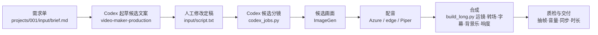

# 项目规划：从文案到听书长视频的自动制作流水线

> 文档修订：r2.2 ｜ 引擎版本：V5 ｜ 更新日期：2026-08-22

## 1. 项目概述

**目标**：在本地搭建一条「文案 → 分镜 → 画面 → 配音 → 字幕 → 合成 → 交付」的完整长视频制作流水线，对标《认知书页》的听书解读长视频（13–18 分钟）。仓库只做长视频，按项目制组织：每个项目一个目录（`projects/001_金钱的艺术`、`projects/002_…`），脚本用 `PROJECT`（默认 `001`）/`--project` 定位。短视频已全部移出本仓库，另开项目。

**内容定位**：听书解读 / 知识解说类（Book Summary / Edutainment）——以「现代人痛点」为导航，把一本书提炼成「思维框架 + 落地工具」；AI 生图不适合真实人物连续画面，故以「每拍独立人物、统一画风」的插画叙事呈现，不追求真人出镜。

**成片规格**：16:9 横屏（1920x1080）、30fps、13–18 分钟、约 4000 字口播（230–250 字/分）、MP4（H.264 + AAC）、响度 -14 LUFS。

## 2. 里程碑

| 里程碑 | 状态 | 内容 |
|---|---|---|
| M0 长视频对标 | ✅ 完成 | 按《认知书页》形态定稿：16:9、五段式 4000 字、画面叙事、金句停顿、Lo-Fi 声场 |
| M1 样片 1.0 | ✅ 完成 | 文字卡视觉雏形（已升级替换） |
| M1.5 Codex 原生编排 | ✅ 完成 | `$video-maker-production` + `codex_jobs.py`：候选资产、可恢复 run、离线校验与人工确认提升；默认无需 API 密钥 |
| M2 文案 AI 化 | ✅ 完成 | DeepSeek 起草五段式完整脚本 + 结构校验/回喂重试 + 人工定稿（`write_long_copy.py`，密钥走 .env） |
| M3 视觉升级 | ✅ 完成 | 画面叙事化：DeepSeek 分镜（80 拍）+ 通义万相插画叙事画面 + 卡点切换 + 运镜/亮度/字幕优化；文字卡降级为回退模式 |
| M4 声音系统 | 🔶 部分完成 | Azure / edge / Piper 与三类 SFX 已接入；逐拍精细节奏对齐待做 |
| M5 批量产能 | ⏳ 规划中 | 多书目项目制批量出片、平台发布参数（封面由独立 Agent 负责） |

## 3. 端到端工作流



**设计原则**：文案是内容基础，由人定稿；语音、画面、文案三个外部能力都可插拔替换，互不影响；流水线自动适配任何音频时长与任何卡点画面；项目路径由 `pipeline/proj.py` 统一解析。

## 4. 模块与接口

| 模块 | 入口 | 技术方案 | 产出 |
|---|---|---|---|
| 项目定位 | `pipeline/proj.py` | `PROJECT`（默认 001）/`--project` 匹配 `projects/{id}_*` 前缀，缺失自动建 `{id}_新项目` | 项目目录 + `project.json` 元数据 |
| Codex 任务编排 | `pipeline/codex_jobs.py` + `$video-maker-production` | 无 API 密钥的候选文案/分镜/图片、可恢复状态、离线校验与人工确认提升 | 候选资产 → 正式项目资产 |
| 长视频文案起草（后备） | `pipeline/write_long_copy.py` | DeepSeek API 起草五段式 3800-4500 字完整脚本；结构校验失败自动回喂重试，`--accept [FILE]` 定稿并备份 | 项目 `input/draft_*.txt` → `input/script.txt` |
| 叙事分镜 | `pipeline/write_storyboard.py` | DeepSeek 把每配音块切 3-5 拍 + 画面提示词 + 逐句字幕表；`--refine` 拆超长拍 | 项目 `input/storyboard_narrative.json` |
| 卡点画面 | `pipeline/write_image_art.py --story` | 通义万相 wan2.7-image（经济版）按分镜生成插画叙事画面 | 项目 `assets/scenes/{块}_{拍}.png` |
| 最终输出分镜 | `pipeline/write_chibi_prompts.py --from-plan` | Codex 本地语义计划（旁白驱动情绪映射 + 角色库 + 主题一致性）→ 装配英文 final prompt（2D chibi + 项目变体 + 角色 + 动作 + 景别 + 16:9）；色彩服务叙事，不强制暖色；DeepSeek 解析为 API 后备 | 项目 `input/storyboard_output.json` |
| 2D Q 版生图 | `write_image_art.py --chibi` | 读 storyboard_output.json，`negative_prompt` 全禁文字/贴纸/图表；构图底部 1/3 字幕安全区 | 项目 `assets/scenes/{块}_{拍}.png` |
| 可读性质检 | `write_image_art.py --tone-check` | 亮度/暗部占比判定 + 提示词可读性风险扫描，输出风险报告；不以冷暖色调判定风险 | 项目 `output/tone_report.md` |
| 配音 | `tts_piper/tts_edge/tts_azure.py` | `TTS_SOURCE=piper|edge|azure` 三选一，输出 44100 单声道 wav；缓存名带配置与文本哈希 | 项目 `audio/voice/blk*_*.wav` |
| 渲染引擎 | `pipeline/build_long.py` | V5：zoompan → 卡点硬切 → 字幕/SFX → 块间 xfade → 三段 BGM ducking/EQ → loudnorm；检测到叙事分镜即进入叙事模式 | 项目 `output/vs2_*.mp4` → 成片 |
| 画面元素库 | `pipeline/long_visuals.py` | Pillow 渲染字幕/书卡/装饰层/程序化底图（ffmpeg 无 drawtext/libass） | 项目 `assets/layers/` |
| 质检 | 附属于构建 | `--frames` 抽帧、ffprobe 规格校验、volumedetect 响度、storyboard `--check` | 项目 `output/preview/`、`long_summary.json` |

## 5. 外部能力接入点

三个外部能力均为「写适配脚本，不碰主流程」：

1. **默认 Codex 制作**：个人 skill `$video-maker-production` 使用 Codex 文本和内置 ImageGen；`codex_jobs.py` 只写本地状态/候选资产，不调用任何 API。候选图片经人工确认才提升，默认拒绝覆盖历史资产。
2. **API 后备**：通义万相（`DASHSCOPE_API_KEY` + `DASHSCOPE_BASE_URL`）与 DeepSeek（`DEEPSEEK_API_KEY`）实现保持不动；仅在明确执行对应命令时调用，随时可恢复批量 API 流程。
3. **语音**：Azure 正式语音（`AZURE_SPEECH_KEY`/`AZURE_REGION`/`AZURE_VOICE`，当前主用晓辰成熟知性女声）、edge-tts（免费无密钥）、Piper（本地男声）三选一，适配器统一输出 wav，时间轴自动适配。

## 6. 质量目标：视觉叙事化

1. ✅ 画面叙事：正文零文字卡，文案由配音 + 底部逐句字幕承载；每拍画面与口播语义严格对应；
2. ✅ 卡点运镜：每拍 zoompan（缓推/横移/上移轮换）+ beat 间硬切，无静止画面；
3. ✅ 转场升级：按块类型映射 xfade（zoomin / fadewhite / 对角光扫 / slideup 等）；
4. ✅ 亮度与干净度：主体可读、曝光均衡；无进度条/阶段徽章；字幕 48px、单屏 ≤15 字；
5. ✅ 基调控制：提示词分层（不变底线 + 项目 visual_style 变体 + 负面清单）+ `--tone-check` 风险报告 + `--warm` 暖化重写；001 风险图待人工勾选重绘；
6. ✅ 画面无文字：2D Q 版负面词全禁文字/数字/贴纸/图表，文字与数据留给引擎字幕与后期；情绪以旁白为准（自动矛盾检测回喂）；主题一致性（角色库 + 禁止年龄身份不符形象）；
7. ✅ 转场防叠影：块内卡点硬切（Ken Burns 保留）、块间 0.3s 方向型 xfade；
8. ✅ v2.0 合成层：全屏铺满 + 底部 15% 渐变遮罩；字幕思源 Heavy 48px 关键词高亮；Ken Burns 5% 轻微档（修复 d=1 静止 bug）；情绪主题背景色板（冷/暖/中性）；收尾 CTA 兜底；
9. 🔶 声音节奏：coin/calc/reveal SFX 已完成，逐拍精细节奏对齐待推进；
10. ⏳ 主角一致性：参考图图生图（`ref_images` 接口已预留），下一条片启用。

## 7. 路线图

- **P1（近期）**：001 重新生成合格的最终输出分镜并补全画面；002 补全剩余画面；随后各跑一条较长样片确认节奏与运镜。
- **P2（两周内）**：书库选题模块（书目筛选 + 痛点对照 + 标题公式）；封面由独立 Agent 开发；主角一致性图生图。
- **P3（月度）**：批量产能化——`PROJECT=002…` 多书目批量出片、各平台规格（YouTube / B 站）预设、留言促活文案模板。

## 8. 风险与约束

- **网络受限**：外部 API（生图 / 文案 / 语音）调用需逐次批准，依赖网络可用性。
- **系统依赖**：Piper 需提权运行；ffmpeg 无 drawtext/libass，文字层由 Pillow 渲染。
- **平台合规**：音色复刻需选择允许复刻的平台；解读文案原创撰写，不复制书中原文；书封使用授权素材或自制文字书卡。
- **成本**：生图走通义万相按张计费；样片阶段用经济版模型并只生成/渲染必要块。

## 9. 验收标准

- 一条成片满足：覆盖 `script.txt` 全部块、13–18 分钟目标、1920x1080/30fps、音画同步、字幕逐句出现、响度接近 -14 LUFS、全片无解码错误。
- 一条人工定稿的新文案 → 分镜 → 卡点画面 → 一键产出成片，全程无需人工剪辑。
- 更换生图 API / 音色 / 文案模型时，仅新增适配脚本，主流水线零改动。
- 每版成片附抽帧预览与构建报告（时长、场景时间轴、文件路径）。

## 10. 目录结构

```text
videoMaker/
├── pipeline/                # 共享代码（proj.py 项目定位 + 构建/起草/生图/TTS）
├── projects/
│   └── 001_金钱的艺术/
│       ├── project.json     #   元数据（id/title/author/status）
│       ├── input/           #   文案与分镜（brief.md / script.txt / draft_* / storyboard_narrative.json）
│       ├── assets/          #   scenes/（卡点画面）、art/（历史底图存档）、layers/（渲染中间层）
│       ├── audio/           #   voice/（配音缓存）、tmp/（合成中间）、music.wav（背景乐）
│       └── output/          #   成片 mp4、vs2_* 分块、preview/ 抽帧、long_summary.json、storyboard_long.csv、tone_report.md
├── assets/piper/            # 共享 Piper 模型（运行时依赖，不入库）
├── docs/                    # 工作流文档（docs/长视频工作流.md）
├── README.md / AGENTS.md / HANDOFF.md / PROJECT_PLAN.md
└── report.pdf               # 频道分析
```

## 11. 下一步行动

1. 001 重建并校验完整最终输出分镜，再补全画面；002 补全已确认分镜的剩余画面；
2. 两个项目分别渲染更长样片（块 00–03+）确认节奏与运镜实感；
3. 封面由独立 Agent 开发（本仓库不包含封面工具）；
4. 主角一致性（参考图图生图）与书库选题模块；
5. 在现有三类 SFX 与 V5 BGM 混音上继续做逐拍精细节奏对齐。

## 12. 目标形态：对标《认知书页》

### 12.1 频道规格解构

- **形态**：13–18 分钟听书解读长视频，约 4,000 字文稿，语速 230–250 字/分钟，稳定多更。
- **选题**：商管 / 财商 / 个人成长畅销书；以「现代人痛点」为导航（内卷耗竭、财务焦虑、职涯觉醒、时间稀缺），而非按书本章节讲述。
- **叙事**：五段式黄金公式——开场共情（约 10%）→ 底层病灶（约 25%）→ 核心模型（约 30%）→ 实战工具（约 25%）→ 哲学升华（约 10%）。
- **声音**：温和、理性、厚重且具信赖感的人声；金句前停顿；Lo-Fi / Ambient warm pad 低音量铺底。
- **视觉**：画面叙事优先——人物 + 故事 + 卡点语义对应，色彩服务情绪且主体可读；正文零文字卡，字幕为唯一文字通道。
- **运营**：标题公式「时间承诺 + 书名标识 + 震撼转折」；结尾布置灵魂提问促发留言互动。

### 12.2 当前流水线差距

| 维度 | 当前（V5） | 目标（认知书页形态） |
|---|---|---|
| 时长 / 规格 | 两个项目均有 1080p 样片，尚无全片 | 13–18 分钟、16:9 横屏 |
| 文案 | 001/002 五段式文案与叙事分镜均通过离线校验 | 人工把关事实 + 标题公式化 |
| 画面 | 001 有 44 张正式图；002 已提升 2 张开场图 | 全片覆盖 + 主角一致性 |
| 声音 | 三 TTS、三类 SFX、三段 BGM ducking/EQ 已接入 | 金句停顿与逐拍节奏精调 |
| 产能 | 项目制已跑到 002，仍需逐项目补图 | 项目制批量（002/003…） |

### 12.3 改造清单

1. ✅ 渲染引擎：分段渲染（每块 vs2_*.mp4）+ xfade 转场，避免单条滤镜链过长。
2. ✅ 画面模板：书卡占位、程序化底图、卡点画面、字幕层（Pillow 绘制 + overlay）。
3. 🔶 声场：三 TTS、SFX 与 V5 三段 BGM 已完成；金句停顿与逐拍节奏仍待精调。
4. ✅ 文案模块：五段式 3,800-4,500 字长稿生成，含结构校验、字数/时长预估与人工定稿。
5. ⏳ 选题模块（新增）：书库选题单——书名 / 作者 / 四大痛点对照 / 爆点 / 标题公式。
6. ✅ 合规：解读文案原创撰写；书卡使用自制文字版式。
